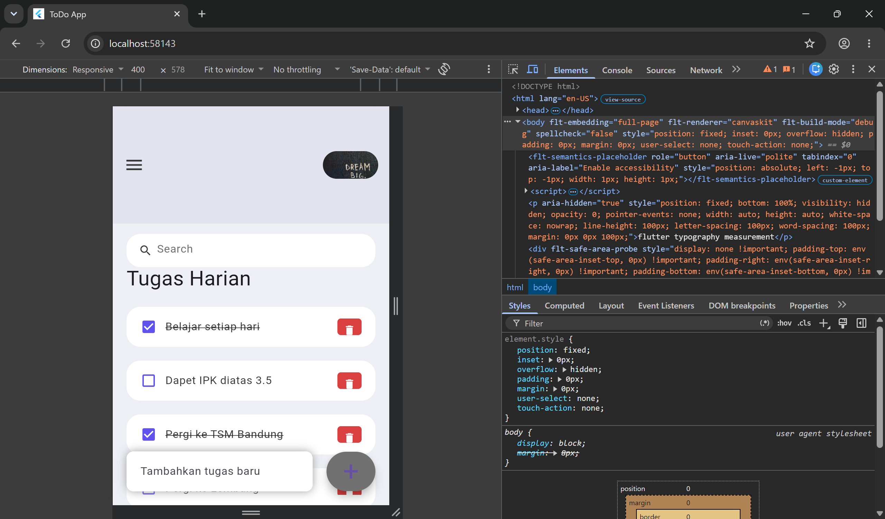
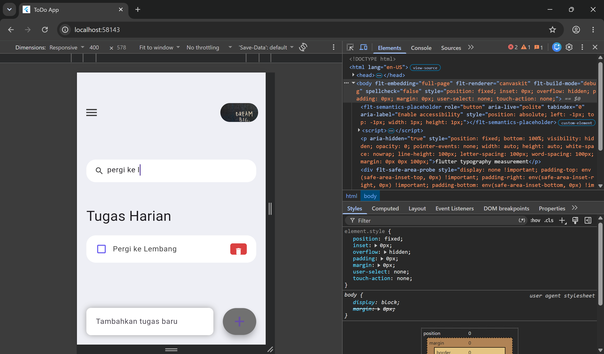

Fransiskus Xaverius Farrell Jovian
103012630031





Cara Menjalankan Aplikasi (How to Run)

1. Pastikan Flutter SDK sudah terpasang di perangkat.
2. Clone repositori ini dan masuk ke direktori proyek:
   ```bash
   git clone [https://github.com/FJO0/Mobile-Programmer.git](https://github.com/FJO0/Mobile-Programmer.git)
   cd Mobile-Programmer
3. Unduh seluruh proyek (flutter pub get)
4. Jalankan aplikasi di emulator atau perangkat yang terhubung (flutter run) 

### Deklarasi Penggunaan AI


- Apakah menggunakan AI? Tidak (belajar dari tutorial YouTube dan referensi repositori orang lain)
- Tool AI yang digunakan: Tidak menggunakan
- Estimasi persentase kontribusi AI: 0%
- Bagian kode/fitur yang dibantu AI: Tidak ada
- Pernyataan:
  "Saya menyatakan bahwa saya memahami alur dan fungsi dari seluruh kode yang ada dalam repositori ini"