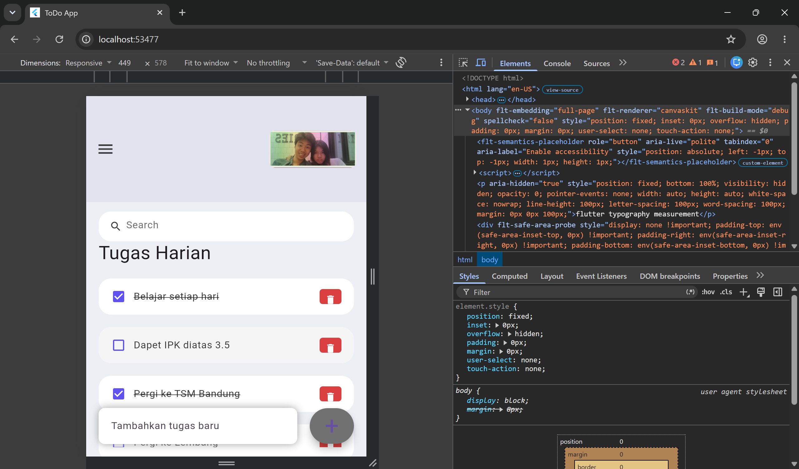
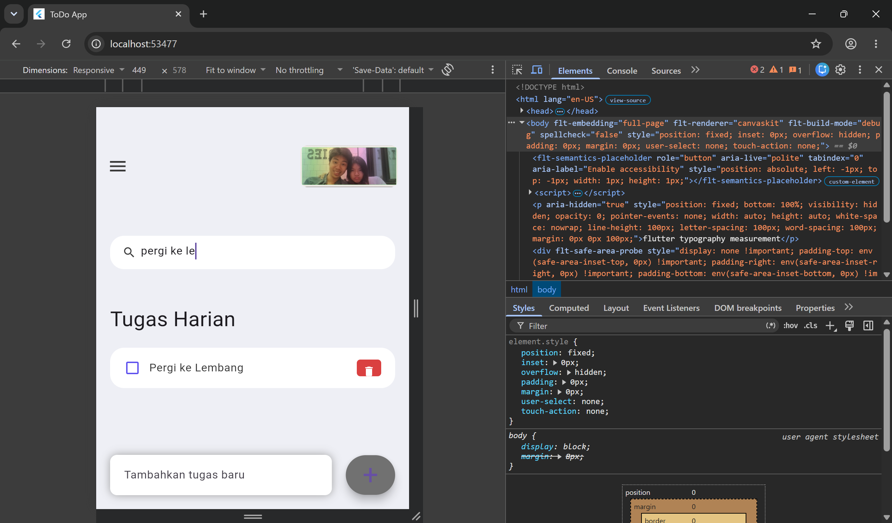
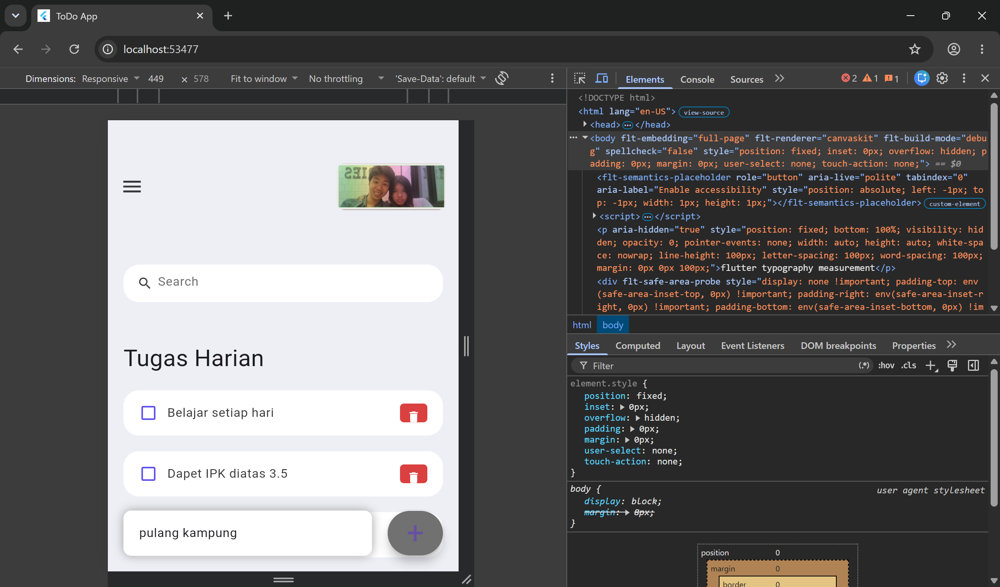

Fransiskus Xaverius Farrell Jovian
103012630031




Cara Menjalankan Aplikasi (How to Run)
1. Pastikan **Flutter SDK** sudah terpasang di perangkat.
2. Clone repositori ini lalu masuk ke folder proyek:
   ```bash
   git clone [https://github.com/FJO0/Mobile-Programmer.git](https://github.com/FJO0/Mobile-Programmer.git)
   cd Mobile-Programmer

- Apakah menggunakan AI? tidak
saya menonton tutorial di youtube dan belajar dari repository orang lain
- Tool AI yang digunakan: Tidak menggunakan

- Pernyataan: 
  "Saya menyatakan bahwa saya memahami alur dan fungsi dari seluruh kode yang ada dalam repositori ini"
